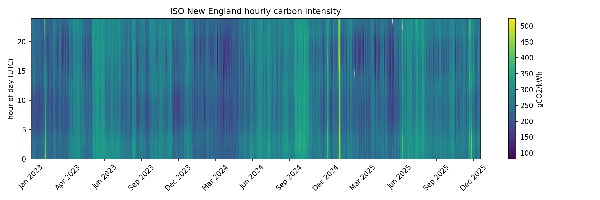

# Project Proposal 1.3

## Intro

### The Goal:

##### Electricity doesn't always have a fixed carbon cost. Every hour, the grid is fed by a changing mix of power sources: gas plants, nuclear, hydro, wind, solar, imports, and oil. Carbon intensity is the CO2 emitted per unit of electricity delivered, usually in grams of CO2 per kWh. It changes hour to hour because the ratio of sources changes. These changes are caused by outside factors such as changes in weather, power demand and dispatch order. By making a model that can forecast the Carbon intensity a day ahead, it allows both the grid and consumers to become proactive rather than reactive, driving down carbon emissions and stabilization costs. This makes it both beneficial for the enviroment, consumers and producers.

**Primary goal:** At noon each day, predict New England's carbon intensity for each of the 24 hours of the next day, using only information available at forecast time, and try to beat baselines on on held-out 2025 data.

**Secondary goals:**
- Cluster the data to see if we can group "types" of days.
- Classify whether each hour of the next day will be "clean" (below an emissions threshold).
- Measure the practical value of the forecast (if a flexible load is scheduled in the forecast's cleanest window, how much CO2 is saved compared with a fixed schedule, and how close does it get to perfect)?

### The Data:

 To have a resonable range on this project I will be limiting this model to only predict the Carbon intensity of New England. I'm choosing New Englang because I live there but also because the region runs a variety of energy sources as it's mostly gas but with steady nuclear as a floor and hydro imports. I'm also choosing New England specifically because most data on energy supply and demand is sorted by balancing authority and New England has their own called ISONE. Additionally, the seasons in New England play a large part in the change of energy sources as during the winter, gas supplies get tight and oil plants run which gives some more variety. 

 I'm specifically getting the data from the U.S. Energy Information Administration: https://www.eia.gov/electricity/gridmonitor/about. They have a helpful dashboard in which you can download the data from any given time range and choose the hourly or daily data on "Generation by Energy Source" or "Demand by Subregion". They also have their own forecasted model which includes their old forecasted data which could be useful. For weather data I will be using https://open-meteo.com/en/docs/historical-weather-api. which has data for hourly temperature, cloud coverage, windspeed, solar radiation and more. However, since the data is only in coordinate/bounding box format, I plan on averaging all of the values for each New England state to get the values to match with the energy supply and demand of the New England grid.

Currently I am planning to use both websites to download the data in xlsx format and use Pandas and NumPy to format it into data the models can work with. However, both websites have API's available which I might utilize. In total I will be using time-based splits for my train and testing data. I currently plan to train on data from 2023-2024 and test on 2025. I'd like to beat the simple baselines: "same hour yesterday" and "same hour last week" to show my model is learning and utilizing the parameters I've given it correctly.

 I found these other websites while searching for data sources for this project. I don't plan on using them for data but they were helpful in visually understanding the data I am working with and the models I plan to build.
- https://www.gridstatus.io/live/isone
- https://www.weather.gov/wrh/climate?wfo=box&tab=cliplot

### Modeling and Features

##### The main features I plan to use with my models are hour, day of week, holidays, temperature (heating and cooling demand), wind and solar forecasts, the grid operator's own load forecast, and lagged intensity.

##### I plan to use the following model schemas and timeline:

| Task | Use | Timeline |
|-------- | -------- | -------- |
| Data Collection and Proposal | Fit data for models | Week 1|
| Clustering: | Run k-means on 24-hour daily intensity curves to find trends in day "types". | Week 2 |
| SVD: | Factor a day x hour matrix to see which few patterns explain most days. | Week 3-4 (in time for check in) |
| Classification: | Predict whether the next hour will be "clean" (below an emissions threshold), comparing trees, Naive Bayes, and SVMs. | Week 5 |
| Neural Network Regression (main model): | Predict carbon intensity directly with linear models. | Week 6-7 |
| Neural Network Evaluation | Finalize model accuracy and output | Week 8-9 (in time for check in) |ß
| Final Write Up and Visualizations | Complete project | Week 10 |

## October Check In

### Building Dataset

#### Weather Data

Fetching the weather data involved making API calls to open-meteo from ranges 2023-01-01 to 2025-12-31 and using the latitude and longitude values for Connecticut (Hartford), Northeast MA (Boston), West/Central MA (Worcester), Southeast MA (Brockton), Maine (Portland), New Hampshire (Manchester), Rhode Island (Providence), and Vermont (Burlington) to aquire data temperature_2m, wind_speed_100m , shortwave_radiation and cloud_cover for each every hour. These were all compiles into their own respective csv files.

#### EIA Data

Fetching the EIA Data involved fetching the data in chunks due to their free limit of at most 5000 pages at a time. Matching the weather data, I got hourly data on eia_fuel_type, eia_region, eia_subregion and eia_interchange for each region in the time period from 2023-01-01 to 2025-12-31. Each of these sub data sets had their own information which had to be combined using the process below

#### Combining Weather and EIA Data

Building the final processed dataset involved combining the weather data with each of the chunks from the EIA datasets. Since the data for the model is indexed by the date and time I choose to take a weighted average of the weather. Each EIA subregion is matched to its weather city by keyword. Every hour, each zone’s share of total demand becomes its weight, so Boston counts for more than Burlington. This produces ne_temperature_2m, ne_wind_speed_100m, ne_shortwave_radiation, and ne_cloud_cover. The EIA fuel type, demand, demand forecast and net values data is for the ISNE alone so no weighted averages are needed. The carbon intensity is calculated by: Σ(generation × emission factor) ÷ total generation as it's weighted by how much each fuel generated that hour.

After combining the datasets, we are left with the following columns:

| Name | Value |
|-------- | -------- |
| period_utc | The hour this row covers, in UTC (6-7 pm EDT) |
| gen_NG | Natural gas generation in MWh that hour |
| gen_NUC | Nuclear generation |
| gen_SUN | Solar generation |
| gen_WAT | Hydro inside New England generation |
| gen_OTH | Other: wood, trash-to-energy, etc |
| gen_PS | Pumped storage hydro (negative when pumping) |
| gen_BAT | Battery storage, discharging (negative when charging) |
| gen_WND | Wind generation |
| gen_OIL | Oil generation |
| gen_SNB | Solar with integrated battery storage |
| gen_COL | Coal |
| net_generation | Total generation inside New England (sum the gen variables) |
| demand | How much electricity New England actually used (per sub region but we sum it) |
| demand_forecast | ISO-NEs day-ahead prediction of demand |
| net_interchange | Net flow with neighbors (Negative = importing) |
| carbon_intensity | gCO2 per kWh generated this hour |
| ne_temperature_2m | Demand weighted New England temperature (Celcius) [a temperature metric adjusted so that regions or weather stations with higher energy consumption or higher population get more weight than sparsely populated or low-energy areas] |
| ne_wind_speed_100m | Wind at 100 m height (km/h) |
| ne_shortwave_radiation |- Sunlight reaching the ground (W/m2) |
| ne_cloud_cover | Percent of sky covered |

### Figures

#### Heat Map

This heat map shows every hour of the three years. Date on the x-axis, hour of day (UTC) on the y-axis, color = intensity.

try k =6 

99% of variance 